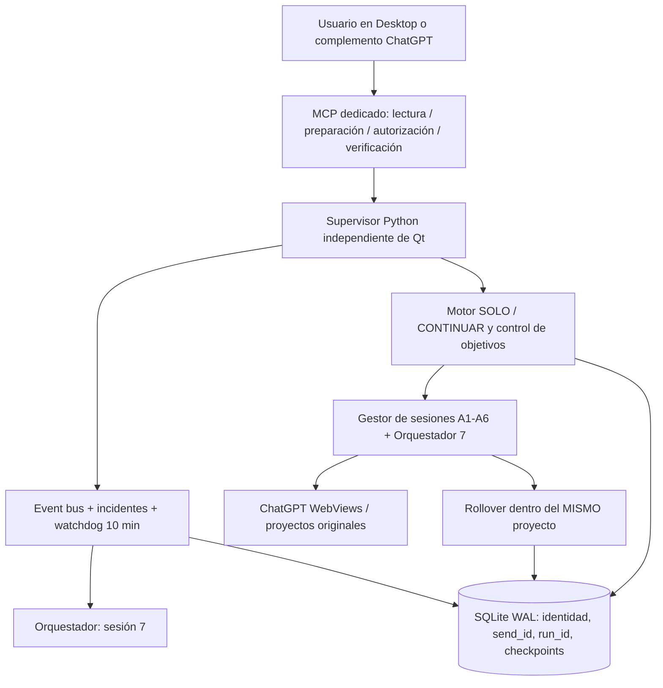

# Plan maestro V6.0 — Central Agéntica Desktop · 7 sesiones persistentes
**Actualización:** 30-10-2026 · **Estado:** PLANIFICADO / IMPLEMENTACIÓN AÚN NO CERTIFICADA
**Épica:** https://github.com/sandrano1605/MCP/issues/12
**Despliegue objetivo:** aplicación de escritorio Windows autorizada. **VPS/cloud fuera de alcance** de esta entrega.

## Política de versiones aisladas (acordada en CA-01, 30-10-2026)

- **V5.7.6 actual:** entorno de trabajo existente, no se modifica, no se reinicia y conserva las conversaciones/autorizaciones originales.
- **V5.7.7-LAB:** primer clon de código en directorio independiente, sin copiar cookies, SQLite, perfiles ni checkpoints. Instancia **9**, API **8798**, `LOCALAPPDATA`/perfil bajo el directorio privado del LAB. Se inicia solo con `launch_v577_lab.py`; requiere login separado si más adelante se autoriza una prueba web.
- **V5.7.8-LAB y posteriores:** una nueva versión por iteración validada; nunca sobrescribir el origen. Se promociona solamente con evidencia, backup y rollback.
- **Canary offline V5.7.7:** 6 trabajadores + séptimo panel orquestador y temporizador de recuperación observados, WebViews desconectadas de internet, almacenamiento aislado. 7/7 pruebas de aislamiento PASS. **NO es prueba de login, Sígueme ni recuperación E2E**.
- La versión LAB se conserva en un repositorio **Git local independiente** sin remoto; no publicar el código operativo ni los datos privados del desktop en el repositorio público de MCP.

## 1. Visión y contrato funcional
Central Agéntica debe mantener **7 sesiones ChatGPT autónomas y separadas**: trabajadores A1–A6 más Orquestador 7. El supervisor Python mantiene las sesiones bajo control, preserva el progreso incluso entre conversaciones cortas, reinicia solamente después de reconciliar la última actividad y no transforma un fallo incierto en un envío duplicado. El control puede venir de la interfaz o de un **MCP dedicado** y privado.

**Condición central:** la tarea concluye por un resultado verificable (criterios de aceptación del objetivo), no por agotamiento arbitrario de tres iteraciones; si el servicio limita, falta autorización, existe incertidumbre o el usuario detiene la ejecución, el sistema conserva el estado y espera legítimamente. Nunca eludir límites de uso o autenticación.

## 2. Arquitectura propuesta

**Separación de responsabilidades:** el supervisor y ledger viven en Python, fuera de las respuestas del Orquestador; el Orquestador decide/escalona según eventos; Qt/WebEngine presenta los chats; el MCP expone acciones autorizadas. Fallar en el panel 7 no debe detener las protecciones deterministas de Python.

### Identidad por ejecución
Guardar **agent_id + project_id + conversation_id + logical_run_id + chat_sequence + handoff_id + objective_id**. El `logical_run_id` permanece al transferir la misma tarea entre conversaciones dentro del proyecto; `conversation_id` cambia; cada envío tiene un `send_id` único y una marca idempotente. Nunca adoptar un `run_id` histórico para otra URL/proyecto.

### Persistencia y continuidad
- Estado durable antes de realizar una acción externa. Respaldo/migraciones atómicas, versionadas y reversibles.
- Checkpoint estructurado por turno: objetivo, entregables, completados, pendientes, evidencias, bloqueos, última entrega y `safe_next_steps`.
- Handoff en dos fases: verificar final y editor seguro → snapshot → preparar nuevo chat del mismo proyecto → inyectar contexto resumido autorizado → confirmar recepción/respuesta → confirmar el nuevo enlace. Si falla, **no** borrar la conversación original.
- Activar rollover al llegar a umbral configurable de presión de contexto, latencia creciente, conteo de turnos o error certificado. No usar un número fijo como única señal.

### Sígueme SOLO + CONTINUAR
- Contrato de objetivo y *Definition of Done* por ejecución.
- Estados: `NEW`, `RUNNING`, `WAIT_RESPONSE`, `WAIT_TOOL`, `WAIT_USER`, `RECOVERING`, `UNCERTAIN`, `DONE`, `CANCELLED`.
- Cada respuesta debe permitir verificar siguiente paso seguro, progreso y estado del objetivo; no reenviar prompts genéricos ni bucles interminables.
- Límite adaptable de iteraciones, latencia, tokens/uso, fallos y `rate limit`; stop del usuario detiene nuevas acciones, conserva checkpoint y no deshace operaciones externas.
- Efectos externos irreversibles requieren gates propios de SAP/PRD/correos/publicación.

### Supervisor y Orquestador
- Watchdog **cada 10 minutos** para revisión sistemática de las siete sesiones; eventos críticos despiertan diagnóstico sin esperar el siguiente ciclo.
- El Python supervisor detecta transporte, editor, errores, progreso, cambio de URL, estado Qt y persistencia. Repara primero fallos deterministas seguros.
- El Orquestador 7 puede inspeccionar, priorizar, asignar tareas, preparar/reanudar SOLO y solicitar recuperación mediante MCP; el controlador verifica el resultado y el `run_id` antes de cerrar un incidente.
- Al caer Qt, supervisión externa con lock/lease, backoff y reconciliación previa. No prometer continuidad de generación si la aplicación o la cuenta están cerradas.

### MCP dedicado y complemento
- MCP local de Central Agéntica, separado del conector general de escritorio, reutilizando la implementación ya preparada en el proyecto local.
- Funciones: estado, inventario de siete sesiones, contexto/checkpoint, asignar tarea al agente elegido, preparar inicio SOLO, aprobar con idempotencia, pausar, diagnosticar, recuperar y verificar.
- Mutaciones con `PREPARE → APPROVE → VERIFY`, autenticación y RBAC; nunca saltarse identidad o un draft.
- El complemento privado se conectará mediante canal HTTPS autenticado **cuando se habilite esa integración**. Un puerto localhost NO es accesible directamente desde ChatGPT cloud y el VPS no es requisito para desarrollar/certificar la lógica local.

## 3. Línea base observada (información operacional resumida)
- Runtime V5.7.6: seis trabajadores presentes; **0/6 Sígueme activo**; panel 7 habilitado pero `bootstrap=UNCERTAIN` y sin `operational=true`.
- Hay **cinco restauraciones históricas** a la espera de la conversación original: el control rehúsa asociarlas a chats nuevos; política correcta, continuidad incompleta.
- Transportes locales ONLINE y sin colas en la inspección; `LISTO` indica disponibilidad del panel, no avance de la tarea.
- Ya existen módulos de continuidad, auto-followup, recuperación y MCP; **reutilizarlos**, evitar duplicar lógica.
- Hay cambios locales anteriores no comiteados en el árbol Qt; realizar backup y commits selectivos, nunca `git add -A`.

## 4. Backlog GitHub — ejecución estricta issue por issue

| Orden | Issue | Prioridad | Entregable / gate |
|---|---|---|---|
| 01 | [#13 CA-01 — Baseline](https://github.com/sandrano1605/MCP/issues/13) | P0 | Siete slots, inventario, backups y pruebas iniciales |
| 02 | [#14 CA-02 — Ledger](https://github.com/sandrano1605/MCP/issues/14) | P0 | Identidad por ejecución y transacciones idempotentes |
| 03 | [#15 CA-03 — Gestor 7 sesiones](https://github.com/sandrano1605/MCP/issues/15) | P0 | Arranque/reinicio con recuperación sin mezclas |
| 04 | [#16 CA-04 — Rollover](https://github.com/sandrano1605/MCP/issues/16) | P0 | Nuevo chat del mismo proyecto con contexto |
| 05 | [#17 CA-05 — Sígueme orientado a objetivo](https://github.com/sandrano1605/MCP/issues/17) | P0 | Continuar hasta DONE / WAIT_USER y checkpoints |
| 06 | [#18 CA-06 — Recuperación](https://github.com/sandrano1605/MCP/issues/18) | P0 | Matriz de errores, recuperación sin reenvío |
| 07 | [#19 CA-07 — Orquestador 10 min](https://github.com/sandrano1605/MCP/issues/19) | P0 | Supervisión independiente, control y verificación |
| 08 | [#20 CA-08 — MCP + asignación](https://github.com/sandrano1605/MCP/issues/20) | P0 | API específica, herramientas, seguridad, plugin |
| 09 | [#21 CA-09 — Rendimiento](https://github.com/sandrano1605/MCP/issues/21) | P1 | Medidas de CPU/RAM/latencia y optimización |
| 10 | [#22 CA-10 — Certificación](https://github.com/sandrano1605/MCP/issues/22) | P0 | E2E, canary, soak, release reversible |

**Ejecución:** cerrar un issue solamente al verificar sus criterios, pruebas y evidencias; actualizar el siguiente si aparecen dependencias. Posible optimización transversal de rendimiento durante todo el desarrollo, sin alterar el orden de certificación.

## 5. Matriz mínima de aceptación de la release
1. **7/7 sesiones** recuperan proyecto, URL, identidad y checkpoint después de 10 reinicios de canary.
2. **10 handoffs** a chat nuevo del mismo proyecto; 0 mezclas de proyecto o `run_id`; resumen de contexto completo.
3. **≥3 turnos consecutivos por trabajador** sin repetición de mensajes y con checkpoint verificable; reconocer DONE y detenerse.
4. **≥8 fallos inyectados** con recuperación o clasificación de espera segura sin acciones duplicadas.
5. **10 verificaciones del supervisor** + prueba de caída del Orquestador con Python activo.
6. **Control MCP**: estado, asignación, autorización y verificación por agente; 401 sin credenciales; permisos efectivos y sin exposiciones públicas indebidas.
7. **Rendimiento**: referencia cuantitativa y soak de ≥2 horas con 7 slots, sin procesos huérfanos o crecimiento incontrolado de RAM.
8. Evidencias PASS para suite offline, integración Qt, E2E, backups, rollback; ante FAIL, estado NO_GO / NOT_CERTIFIED.

## 6. Método de trabajo (sprints y change control)
**Sprint 0 — CA-01:** inventario, baseline, diff/backup, mapa de dependencias, snapshot del runtime y de tests.
**Sprint 1 — CA-02 y CA-03:** ledger y ciclo de vida de siete sesiones.
**Sprint 2 — CA-04 a CA-06:** rollover, SOLO objetivo y recuperación idempotente.
**Sprint 3 — CA-07 y CA-08:** Orquestador, watchdog y MCP/plugin.
**Sprint 4 — CA-09 y CA-10:** benchmark, resiliencia, E2E/canary y release.

Cada issue: **Diagnóstico → diseño mínimo → fix aislado → unit tests → integración → evidencia real → revisión seguridad → commit selectivo → verificación de despliegue**. No confundir un commit local con GitHub publicado.

## 7. Seguridad, datos y operación
- No publicar: secretos, claves, cookies, identificadores empresariales privados, transcripciones, perfiles, bases SQLite, logs o respaldos reales.
- Ante respuesta `UNCERTAIN`: conservar borrador y último envío, conciliar DOM + journal + SQLite antes de cualquier nuevo mensaje. Sin Retry automático.
- Autenticación, MFA y límites del servicio son gates; el sistema **no** debe intentar eludirlos.
- Nunca modificar datos SAP productivos, hacer SAP COMMIT, enviar correo o publicar información sin sus autorizaciones correspondientes.
- No reconstruir la aplicación: conservar V5.7.6 y preparar cambios verificables y reversibles; VPS y virtualización futura son otra épica.

## 8. Próxima ejecución
**Empezar exclusivamente por [CA-01 #13](https://github.com/sandrano1605/MCP/issues/13):** inventario profundo de archivos y flujos efectivos, revisión del estado Git actual, respaldo selectivo, mapa de procesos de las siete sesiones, pruebas baseline y checklist de gating para CA-02. Ningún agente debe recibir mensajes durante esta etapa de diagnóstico.
